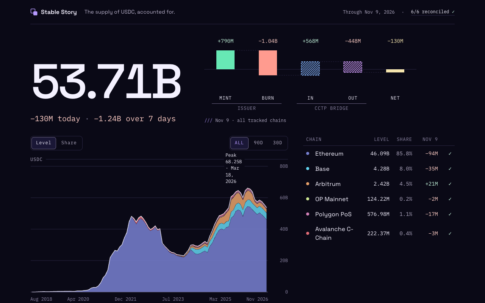
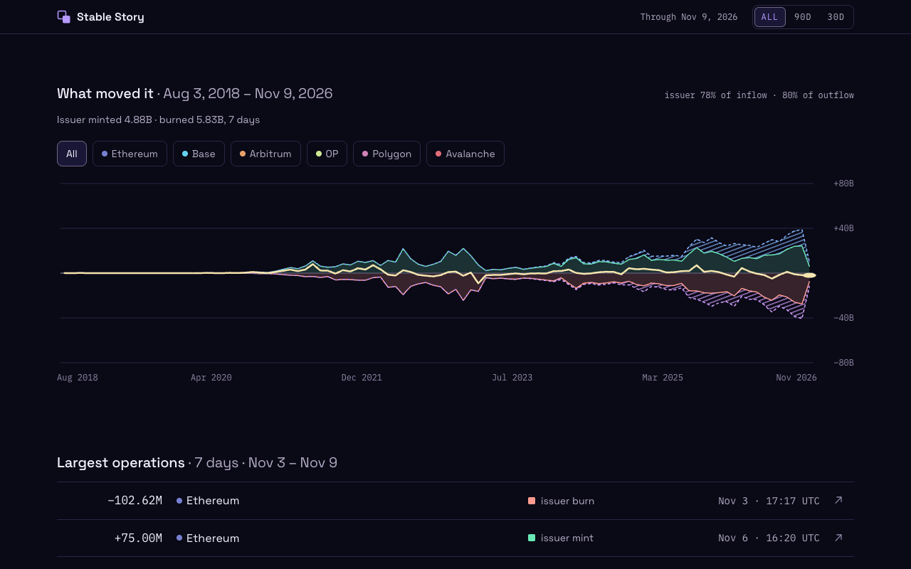

# Stable Story

[**The supply of USDC, accounted for.**](https://stable-story.vercel.app)

USDC supply across Ethereum, Base, Arbitrum, OP Mainnet, Polygon PoS, and Avalanche C-Chain — every closed day attributed to Circle (issuer) or the CCTP bridge, and reconciled against the on-chain contract.

`live` · `updated daily` · `six chains`



## What makes it unusual

- **Every day is reconciled against the contract.** Each closed chain-day runs three checks: computed supply vs. on-chain `totalSupply`, cross-chain CCTP V1/V2 burn-to-mint pairing, and day-over-day continuity. Unpaired supply logs and mismatched days stay visible and flagged on the page — never silently dropped or zeroed.
- **No database server in production ($0/month hosting).** The analytical backend (log ingestion, pairing, reconciliations, Postgres) runs locally and publishes immutable, versioned read-only JSON documents to private Cloudflare R2 after each day closes. The Next.js App Router site renders on the server from that prepared document; the browser makes no API or storage requests and receives no credentials.
- **~600 lines of Zod cross-field invariants.** Every response and publication envelope is validated by [`packages/contracts/src/schemas.ts`](packages/contracts/src/schemas.ts) and [`publication.ts`](packages/contracts/src/publication.ts), with negative unit tests asserting the exact error path for each broken invariant.

## Start here

1. **Live site:** [stable-story.vercel.app](https://stable-story.vercel.app)
2. **Data contract:** [`packages/contracts/src/schemas.ts`](packages/contracts/src/schemas.ts) and [`packages/contracts/src/publication.ts`](packages/contracts/src/publication.ts) — schemas, cross-field invariants, and the R2 pointer/manifest envelope.
3. **Shared view logic:** [`packages/view`](packages/view) — pure TypeScript formatting, quality flags, day equation, period selection, and chart scales (`Intl` and ES APIs only; never aggregates or re-buckets).
4. **System architecture:** [`docs/architecture.md`](docs/architecture.md) — end-to-end data flow with the analytical backend documented as an interface-level black box.
5. **Data quality & sample payload:** [`docs/data-quality.md`](docs/data-quality.md) and [`docs/overview-example.md`](docs/overview-example.md) ([`overview-example.json`](docs/overview-example.json)) — the three daily reconciliations, CCTP pairing rules, gap policy, and an annotated `overview` excerpt.

## What the page shows

The page is rendered from a single prepared `overview` document in five blocks:

- **Hero & daily waterfall** — tracked USDC supply across all six chains, 1-day and 7-day deltas, and the latest closed day's five-bar waterfall (`mint`, `burn`, `bridge in`, `bridge out`, `net`).
- **Supply stack & chain list** — per-chain levels and shares at three server-computed resolutions: `30D` by day, `90D` by week (exact 90-day window), and `ALL` by calendar month from the earliest covered day of any chain. Chains before their coverage start carry `null` ("no data"), never `0`.
- **Flows (`What moved it`)** — issuer mint/burn (solid bands) against CCTP bridge in/out (hatched bands) and net flow, filterable by chain.
- **Largest operations & records** — the 20 largest operations of the last 7 days linked to chain explorers (with CCTP version and peer chain), followed by all-time highs and per-chain reconciliation status.



## Workspace layout

| Package | Role | Allowed workspace imports |
|---|---|---|
| [`apps/web`](apps/web) | Next.js App Router page (dynamic SSR, zero client data fetching) | `contracts`, `tokens`, `view` |
| [`apps/mobile`](apps/mobile) | Expo SDK 58 / React Native 0.88 app (`Today`, `History`, `Operations`, `Chain`) | `contracts`, `tokens`, `view` |
| [`packages/contracts`](packages/contracts) | Zod schemas, DTOs, `ApiClient` (HTTP & mock), publication envelope | — |
| [`packages/tokens`](packages/tokens) | Typed design tokens (`Violet Observatory`); generates web `tokens.css` and native theme | — |
| [`packages/view`](packages/view) | Pure view transformations, scales, and tooltip models | `contracts` (types only) |

Module boundaries are enforced by ESLint (`eslint.boundaries.js`) across static imports, dynamic imports, re-exports, and type imports.

## Checks

| Command | What it proves |
|---|---|
| `pnpm typecheck` | Strict TypeScript (`erasableSyntaxOnly`, `verbatimModuleSyntax`) across the root and all packages. |
| `pnpm lint` | ESLint 10 type-checked rules and module-boundary enforcement. |
| `pnpm test` | Vitest unit suite: Zod contract invariants (with negative path assertions), view logic, and SSR page checks. |
| `pnpm check:build` | Production Next.js build with self-hosted fonts only, zero R2/API credential leaks in client bundles, and the HTML/RSC daily-window check (no daily chart values older than 30 days). |
| `pnpm browser-smoke` | Headless Chrome across every mock state (`ok`, `delayed`, `unreconciled`, `empty-day`, `short-history`, `gap`, `empty`, `unavailable`, `long-history`) at desktop, phone, and stress widths. |
| `pnpm test:rn` | Jest / React Native component suite for the Expo mobile app. |

```bash
pnpm install
pnpm typecheck && pnpm lint && pnpm test
env -u AI_AGENT -u CLAUDECODE pnpm check:build
CI=true env -u AI_AGENT -u CLAUDECODE pnpm browser-smoke
pnpm test:rn
```

## Mobile

[`apps/mobile`](apps/mobile) is an Expo (React Native) client built on the same `contracts`, `tokens`, and `view` packages, without sharing UI components with the web app. It reads the same prepared `overview` document through a Cloudflare Worker guarded by Firebase App Check and ships to users after the web launch.

## Known limitations

- *Stable Story* is a working name and may change.
- `ALL` starts at the earliest covered day of any enabled chain (`2018-08-03` on Ethereum); older periods are pre-bucketed by week (`90D`) and calendar month (`ALL`) on the server, and the client never re-aggregates.
- There is no public API or raw data export by design — the page is the interface.
- GitHub Actions CI runs on manual dispatch (`workflow_dispatch`).
